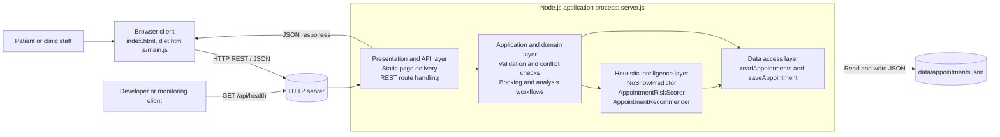
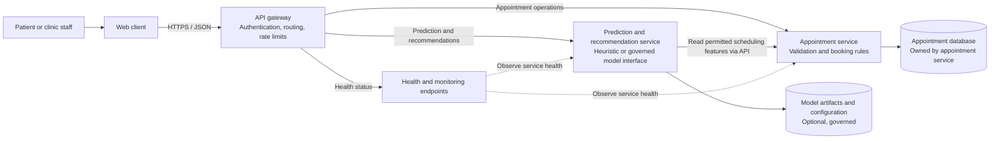

# Software Architecture Design

## Purpose and Scope

This document maps the current MEdicare demo implementation to a layered client-server architecture and presents a separate conceptual microservices view for system architecture planning. The microservices view is a possible evolution, not a description of deployed code.

The system supports clinic appointment requests, schedule checks, and heuristic appointment analysis. It is an educational demo and is not suitable for real patient data or clinical decision-making.

For the template-based analysis of module decomposition, design strategy, coupling, cohesion, and interactions, see [SOFTWARE-DESIGN-ANALYSIS-REPORT.md](SOFTWARE-DESIGN-ANALYSIS-REPORT.md).

## Current System Architecture

### Layer Responsibilities

| Layer | Current implementation | Responsibility |
| --- | --- | --- |
| Client / presentation | `index.html`, `diet.html`, `js/main.js`, `css/style.css` | Render pages, gather booking input, call the API, and display results. |
| API / transport | HTTP routes in `server.js` | Serve static files and expose appointment, health, and ML endpoints over HTTP/JSON. |
| Application / domain | Request handling and helper functions in `server.js` | Validate appointment input, reject conflicts, coordinate persistence and analysis, and format responses. |
| Intelligence | `js/ml-models.js` | Calculate heuristic no-show estimates and risk scores; rank slot and doctor recommendations. |
| Persistence | File operations in `server.js` and `data/appointments.json` | Read and write appointment records in a local JSON file. |
| Runtime / infrastructure | Node.js built-in `http`, `fs`, `path`, and `crypto` modules | Provide the HTTP listener, filesystem access, path handling, and request IDs. |

These are logical layers, not independently deployed modules. In particular, API routing, application workflows, and file persistence currently share `server.js` and one Node.js process.

## Client-Server Design

The browser is the client and communicates with the Node.js server using HTTP. The server currently serves the browser pages and handles REST-style JSON endpoints in the same process.

| Endpoint | Purpose |
| --- | --- |
| `GET /api/health` | Report service availability. |
| `POST /api/appointments` | Validate, conflict-check, analyze, and save an appointment request. |
| `GET /api/appointments` | Return stored appointment records. |
| `POST /api/ml/predict` | Return heuristic prediction and risk values. |
| `POST /api/ml/recommend-slots` | Return available-slot recommendations. |
| `POST /api/ml/recommend-doctors` | Return doctor recommendations. |
| `GET /api/ml/analyze/:appointmentId` | Analyze a stored appointment by ID. |

The appointment request flow is: browser form → HTTP/JSON API → validation and conflict check → heuristic analysis and JSON persistence → JSON response → browser confirmation and insights.

## Conceptual Microservices Architecture

This target view illustrates a possible decomposition if independent scaling, team ownership, or deployment becomes necessary. It is not implemented today. The current single server, in-process models, and JSON file would need to be replaced or separated deliberately; introducing services adds operational, security, and data-consistency costs.

The appointment service owns appointment writes and consistency rules. The intelligence service receives only the scheduling data it needs through an explicit service contract; it should not directly modify appointment records. An API gateway is a proposed edge component, not a current server or package.

## Design Patterns and Principles

| Pattern or principle | Mapping to this project | Status |
| --- | --- | --- |
| Layered architecture | Browser/presentation, HTTP API, application/domain logic, heuristic models, and persistence responsibilities. | Present as logical separation; several backend layers are co-located in `server.js`. |
| Client-server | Browser pages call the Node.js HTTP server through JSON endpoints. | Implemented. |
| Separation of concerns | `js/main.js` handles browser behavior and `js/ml-models.js` contains model classes. | Partially implemented; routing, use-case logic, and persistence are coupled in `server.js`. |
| Repository / data-access boundary | `readAppointments()` and `saveAppointment()` centralize JSON file access. | Repository-like functions; no formal repository interface or class. |
| REST-style resource API | Appointment collection and analysis endpoints exchange JSON over HTTP. | Implemented as lightweight routes; not a complete REST maturity model. |
| API Gateway | A single entry point would route requests to independently deployed services. | Conceptual microservices target only. |
| Strategy | Could standardize interchangeable prediction implementations behind a shared interface as models evolve. | Future design option; current model classes are called directly. |

## Industry Mapping: System Architecture Planning

| Architecture-planning concern | MEdicare mapping / planning output |
| --- | --- |
| Business capability and stakeholders | Patient booking, clinic scheduling and review, developer operations, and service-health monitoring. |
| System context and containers | Browser client, Node.js API/runtime, heuristic logic, and appointment persistence, shown in the current-state diagram. |
| Architecture style | Document the existing layered client-server monolith separately from the conceptual service decomposition. |
| Data ownership and integration | The JSON file is the current single store. A service-oriented target assigns appointment data ownership to the appointment service and uses explicit contracts for other consumers. |
| Quality attributes | Prioritize correctness of booking conflicts, availability, maintainability, performance appropriate to demo scale, privacy, and security. |
| Deployment and operations | Current run target is one Node.js process (`npm start`). A microservices target would additionally require service deployment, configuration, observability, and failure handling. |
| Security and healthcare constraints | Do not use real patient data in the current demo. A production plan must evaluate authentication, authorization, encryption, audit trails, data retention, privacy obligations, and applicable healthcare regulations with qualified stakeholders. |
| Evolution decision | Keep the monolith for the current educational scope. Consider service extraction only when independent scaling, ownership, or release needs justify distributed-system complexity. |

## Planning Assumptions and Risks

- Prediction and risk outputs are heuristic estimates, not validated clinical decisions.
- `data/appointments.json` is suitable only for local demonstration; concurrent writes, access control, backups, and database integrity are not production-ready.
- The current API includes permissive cross-origin response headers and has no authentication or role-based authorization; deployment with sensitive data requires a security redesign.
- Microservices would require explicit API contracts, service-to-service security, resilience and timeout policies, centralized observability, and a data migration plan.