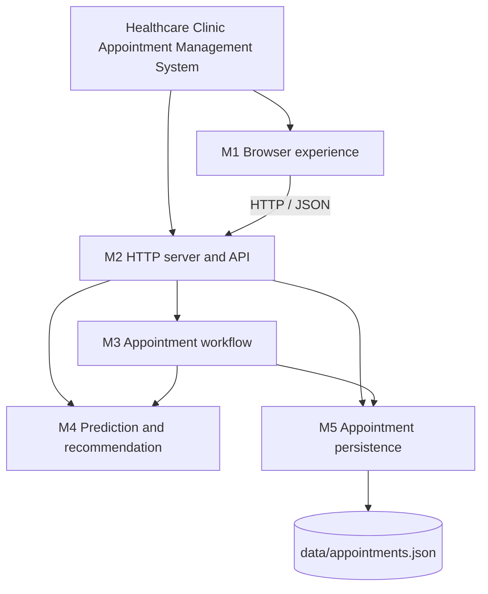
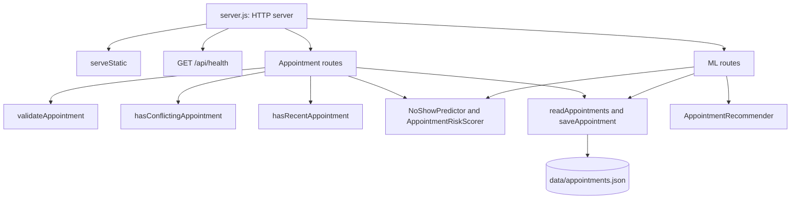
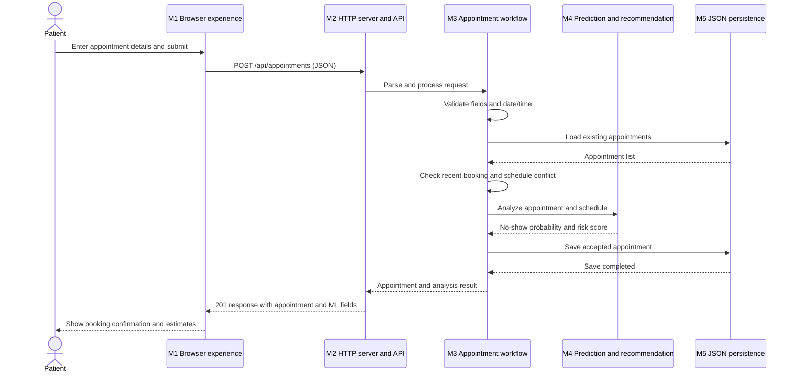

# Software Design Analysis Report

## A. Project Details

- **Project title:** Healthcare Clinic Appointment Management System (MEdicare demo)
- **Team / roll numbers:** Not provided in the repository.
- **Project objective:** Let patients request clinic appointments through a browser, validate and persist requests, prevent scheduling conflicts, and provide heuristic appointment risk and scheduling recommendations.
- **Technology stack:** HTML, CSS, browser-side JavaScript, Node.js 18+, Node.js built-in `http`, `fs`, `path`, and `crypto` modules, and JSON-file persistence. The project has no declared third-party runtime dependencies.

## B. Module Identification and Modularization

The current design has **five logical modules**. These are responsibility boundaries for analysis, not five independently deployed services: the API host, appointment workflow, and persistence functions are currently co-located in `server.js`.

| Module ID | Module name | Main responsibility | Inputs / outputs | Depends on |
| --- | --- | --- | --- | --- |
| M1 | Browser experience | Render the booking and diet pages, collect appointment details, call the API, and display booking and prediction results. | Form values and HTTP responses in; rendered pages, requests, status, and prediction display out. | M2 through HTTP/JSON; HTML and CSS assets. |
| M2 | HTTP server and API | Serve static files, dispatch health, appointment, and ML routes, and serialize HTTP responses. | HTTP method, URL, headers, and body in; status code, headers, and JSON or static content out. | M3, M4, M5 (logical dependencies); Node.js `http`, `path`, and `fs`. |
| M3 | Appointment workflow | Validate requests, apply booking rules, coordinate analysis and persistence, and form appointment results. | Appointment request and schedule data in; accepted appointment or validation/conflict response out. | M4 for analysis; M5 for stored appointments. |
| M4 | Prediction and recommendation | Calculate heuristic no-show probability and risk, and recommend slots and doctors. | Appointment data and schedule in; scores and recommendation lists out. | Appointment data supplied by M3 or M2; other model classes in `js/ml-models.js`. |
| M5 | Appointment persistence | Load and save appointment records in the local JSON store. | Appointment records in; appointment arrays out. | `data/appointments.json`; Node.js `fs` and `path`. |

### Module hierarchy / decomposition



The diagram shows logical responsibilities. M2, M3, and M5 are not yet isolated files or packages; their current implementation is principally in `server.js`. M1 is implemented by `index.html`, `diet.html`, `css/style.css`, and `js/main.js`; M4 is implemented by `js/ml-models.js`.

## C. Design Strategy

- **Selected strategy:** Hybrid (top-down decomposition with bottom-up reuse).
- **Justification:** The main user goal—requesting an appointment—was decomposed into browser interaction, API handling, booking rules, analysis, and persistence. This top-down view keeps the modules aligned to project responsibilities and requirements. The implementation also reuses Node.js built-in modules and the prediction/recommendation classes when wiring the routes, which is a bottom-up integration step. A hybrid strategy fits a small demo because it makes the workflow understandable without introducing unnecessary service or package boundaries.
- **Evidence / decomposition and build-up:** Start with the booking use case and its inputs and outcomes; identify validation and scheduling rules; identify prediction and storage as supporting responsibilities; then connect the browser, routes, workflow, models, and JSON store. The current code reflects this in the API route handlers and helpers in `server.js`, model classes in `js/ml-models.js`, and browser request flow in `js/main.js`.

```text
Booking use case
  ├── Browser form and result display
  ├── HTTP request / response
  └── Appointment workflow
       ├── Validate and check schedule
       ├── Analyze appointment ── reuse prediction classes
       └── Persist appointment ── reuse JSON file operations
```

## D. Design Approach

- **Selected approach:** Mixed (function-oriented and object-oriented).
- **Justification:** The server is primarily function-oriented: route handling and helper functions such as `validateAppointment`, `hasConflictingAppointment`, `readAppointments`, and `saveAppointment` coordinate the booking flow. Prediction and recommendation behavior is object-oriented through `NoShowPredictor`, `AppointmentRiskScorer`, and `AppointmentRecommender`. This matches the code that exists today and separates reusable model behavior from request orchestration. The approach is only partially modular at the server boundary because routes, workflow, and persistence still share `server.js`.

### Structure chart



This chart follows the current `server.js` route and helper structure. The names in the chart describe logical responsibilities; they are not separate server modules unless explicitly represented by a source file.

## E. Coupling Analysis

| Module pair | Interaction / shared data | Coupling type / level | How to reduce dependency |
| --- | --- | --- | --- |
| M1 Browser experience ↔ M2 HTTP server and API | Appointment request and response JSON over HTTP; endpoint paths and response fields form the contract. | Data coupling; **low**. The browser and server communicate through an explicit transport format. | Keep a documented, stable API schema and test request/response shapes; avoid exposing internal storage fields unnecessarily. |
| M2 HTTP server and API ↔ M3 Appointment workflow | Route handlers pass request-derived objects, inspect returned values, and select HTTP status codes. These concerns are currently in the same `server.js` file. | Data/control coupling; **high at the source boundary** because there is no separately defined workflow interface. | Move booking use cases into a focused module with explicit inputs and result/error types, leaving HTTP status mapping in the API layer. |
| M3 Appointment workflow ↔ M4 Prediction and recommendation | Appointment objects and appointment lists are passed to prediction/scoring and recommendation methods. | Data coupling; **moderate**. Callers need to know the model method inputs and result fields. | Define a small analysis interface and pass only the features each operation needs; keep heuristic implementation details behind it. |
| M3 Appointment workflow ↔ M5 Appointment persistence | Workflow reads the appointment collection and saves an appointment through functions that read/write the JSON file. | Data coupling with shared-file dependence; **moderate to high**. Persistence behavior and storage format are tied directly to the workflow implementation. | Extract a repository boundary with operations such as `list` and `add`; keep file format and filesystem operations behind that boundary. |
| M2 HTTP server and API ↔ M5 Appointment persistence | API handlers access stored appointments for list and analysis routes. | Data coupling; **moderate**. API behavior depends on the current storage helper and JSON representation. | Route storage access through the M3 use cases or an explicit repository interface rather than reading storage from route handlers. |

The browser/API boundary is the loosest current interaction. The highest coupling is inside the server process, where route, workflow, and storage responsibilities share a file and direct calls. The recommended reductions are future refactoring options, not changes already implemented.

## F. Cohesion Analysis

| Module | Main responsibility | Cohesion type / level | Improvement, if needed |
| --- | --- | --- | --- |
| M1 Browser experience | Collect booking input, submit it, and show confirmation and analysis results. | Functional / **high** for the booking interaction. The page and script also include other presentation concerns, such as the diet page. | Keep browser behaviors grouped by page or user feature if more interactions are added; avoid embedding server business rules in the client. |
| M2 HTTP server and API | Host static assets, dispatch API routes, and format HTTP responses. | Logical / **low to moderate**. Static delivery, health checks, appointment operations, and ML operations are grouped by their use of the HTTP server. | Separate static serving and route registration from use-case logic; keep this small while the demo remains single-process. |
| M3 Appointment workflow | Validate and process a booking, enforce scheduling rules, request analysis, and persist the result. | Sequential / **moderate to high**. Its tasks belong to the same booking use case but are not a separate source module today. | Extract a booking service and keep transport parsing, persistence mechanics, and model implementation details outside it. |
| M4 Prediction and recommendation | Estimate no-show and risk scores and rank available slots/doctors. | Functional at the class level / **high**; the source file groups multiple related intelligence features, giving the file as a whole **moderate** cohesion. | Retain the current feature grouping for this scale; split predictors from recommenders only if their responsibilities or release needs grow. |
| M5 Appointment persistence | Read and append appointment records in the JSON data file. | Functional / **high** for the current local-store behavior. | Preserve a narrow repository interface and replace the JSON implementation if stronger concurrency or durability is required. |

## G. Module Interaction and Design Quality

The following sequence describes the current successful booking path. Validation, cooldown, and conflict checks can stop processing with an error response. The prediction values are heuristic demo outputs, not clinical assessments.



### Design quality summary

- **Strengths:** The browser/API boundary uses HTTP and JSON; prediction logic is in a separate source file; booking input is checked server-side; scheduling conflicts are checked before saving.
- **Current limitations:** Three backend responsibilities (HTTP dispatch, booking orchestration, and file persistence) are coupled in `server.js`. JSON-file persistence is intended for local demonstration rather than concurrent or production use. Prediction logic is heuristic and is not validated for clinical decisions.
- **Practical next step:** If the project grows, first extract the appointment workflow and repository behind small interfaces. Keep the current single-process architecture until independent deployment or scaling is genuinely needed.

